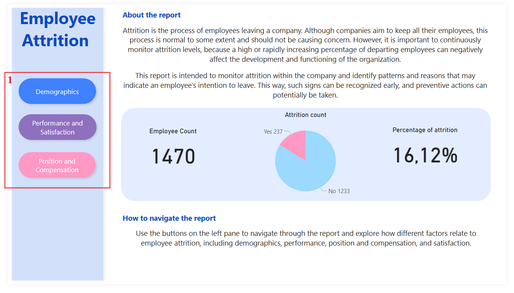
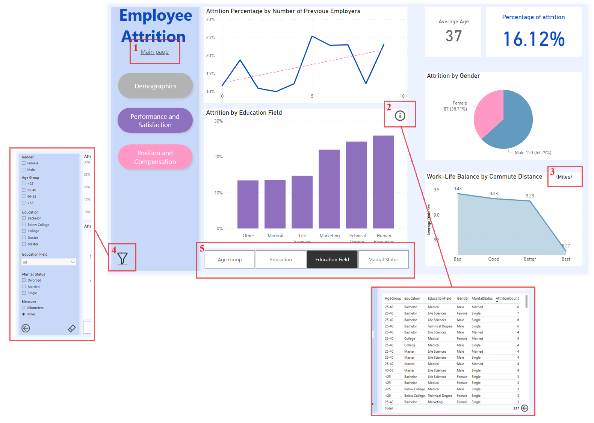
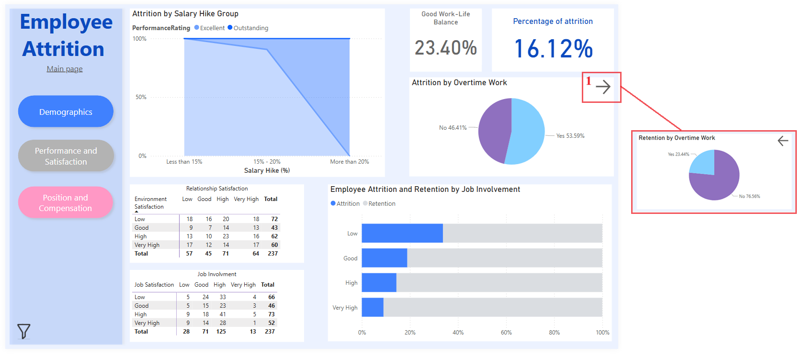
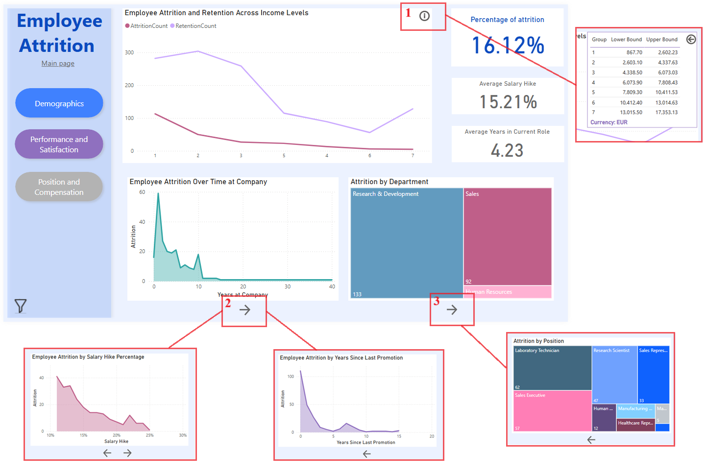
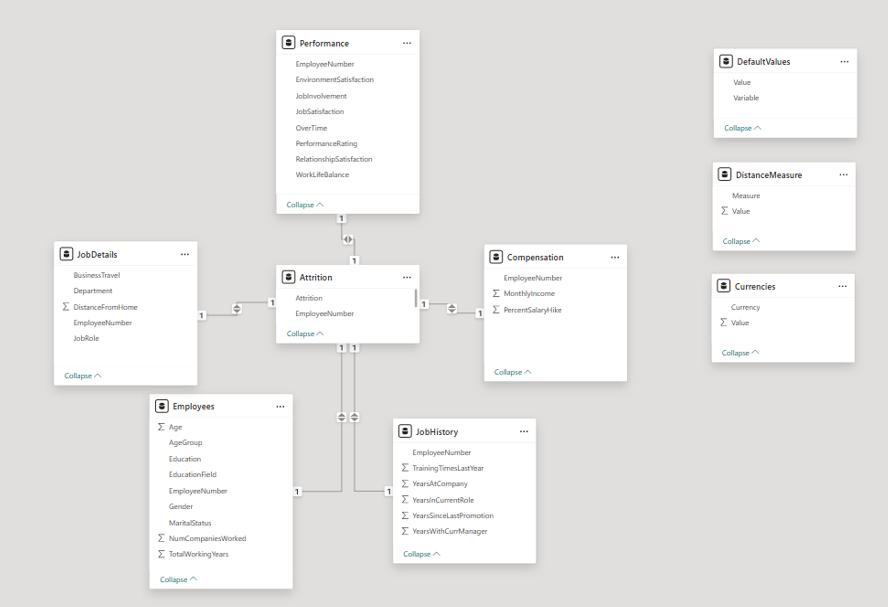

# HR Employee Attrition Dashboard (Power BI)

An interactive Power BI report that shows why employees leave a company. The raw HR data is cleaned and remodelled into a star schema in Power Query, then presented as a navigable, multi-page dashboard covering demographics, performance and satisfaction, and position and compensation.

## Business goals

The report was designed to help an HR team:
- Analyse attrition by gender, age, department, role, salary, tenure and other factors
- Identify the profile of employees most likely to leave
- Find the departments and roles with the highest attrition risk
- Understand how job involvement and satisfaction relate to attrition

## Key insights

- **Overall attrition is 16.1%** (237 of 1,470 employees).
- **Age and marital status matter most among demographics.** Almost **40% of employees under 25 leave**, compared with 10–17% in other age groups. **25% of single employees** leave.
- **Highest-risk profile:** a single man under 25 with a bachelor's degree. **66.7%** of this group left.
- **Overtime more than doubles the attrition rate.** Low job involvement is also linked to leaving.
- **Satisfaction isn't the whole story.** Many employees left despite high satisfaction with their environment and relationships, which points to factors like growth opportunities or pay.
- **Tenure:** most leavers had about one year at the company, and very few with 10+ years left.
- **Sales has the highest relative attrition**, by department (Sales) and by role (Sales Representative). The lowest income band has the highest attrition rate.
- Employees who live closer to work rate their work–life balance higher.

## Report pages

**1. Home page:** introduction, headline KPIs (employee count, attrition %) and navigation buttons.

**2. Demographics:** attrition by number of previous employers, gender and commute distance, plus a column chart where the user picks the dimension (age group, education, education field or marital status) using a field parameter. A button opens a detailed employee table.

**3. Performance & Satisfaction:** attrition by salary-hike group and performance rating, overtime (toggle between leavers and stayers), job involvement, and satisfaction matrices.

**4. Position & Compensation:** attrition and retention across income bands, tenure, salary hike and years since last promotion, plus treemaps by department and job role. Arrow buttons switch between related charts.

## Data model

The source is a single flat table. It was remodelled in Power Query into a **star schema**, to simulate building a small data warehouse:

- **Fact table:** `Attrition` (attrition flag + `EmployeeNumber` key)
- **Dimension tables:** `Employees` (demographics), `JobDetails`, `Performance` (satisfaction and involvement), `JobHistory` and `Compensation`
- **Helper tables:** `DefaultValues` (constant columns moved out of the model), `DistanceMeasure` and `Currencies` (unit and currency conversion)
- **`MeasuresTable`:** a dedicated table holding all DAX measures, organised into folders

### Data preparation (ETL)
- Checked for missing values and outliers (none found).
- Moved constant columns (`EmployeeCount`, `Over18`, `StandardHours`) into a separate helper table.
- Dropped ambiguous columns: unlabelled ordinal levels (`JobLevel`, `StockOptionLevel`) and the inconsistent `HourlyRate`, `DailyRate` and `MonthlyRate`. `MonthlyIncome` is kept as the single salary measure.
- Replaced numeric codes in ordinal variables (e.g. satisfaction 1–4) with readable labels.
- Added conditional columns for grouping: `AgeGroup`, `SalaryHike_Group` and `MonthlyIncome_Group` (7 income bands).

## Features & techniques

- **DAX measures:** attrition %, attrition and retention counts, attrition-to-retention ratio, average age, average salary hike, good work–life balance %, and more
- **Dynamic currency conversion:** salary values recalculate in the currency the user picks (DAX `SWITCH`)
- **Dynamic distance units:** miles or kilometres, chosen by the user
- **Field parameter** for switching the chart dimension on the Demographics page
- **Bookmarks + buttons:** page navigation, collapsible filter panes, chart toggles and pop-up info tables
- **Custom theme** built from a corporate colour palette (JSON), with a consistent layout and navigation bar on every page

## Data

[IBM HR Analytics Employee Attrition & Performance](https://www.kaggle.com/datasets/pavansubhasht/ibm-hr-analytics-attrition-dataset) (Kaggle): a **fictional** dataset created by IBM data scientists. It has 1,470 employees and 35 variables. Salaries are assumed to be in USD and distances in miles.

## How to open

1. Download and install [Power BI Desktop](https://www.microsoft.com/power-bi/desktop) (free, Windows).
2. Download `HR_Attrition_Report.pbix` from this repo and open it. The data is already included in the file.

## Tools

Power BI Desktop · Power Query (M) · DAX · data modelling (star schema)
